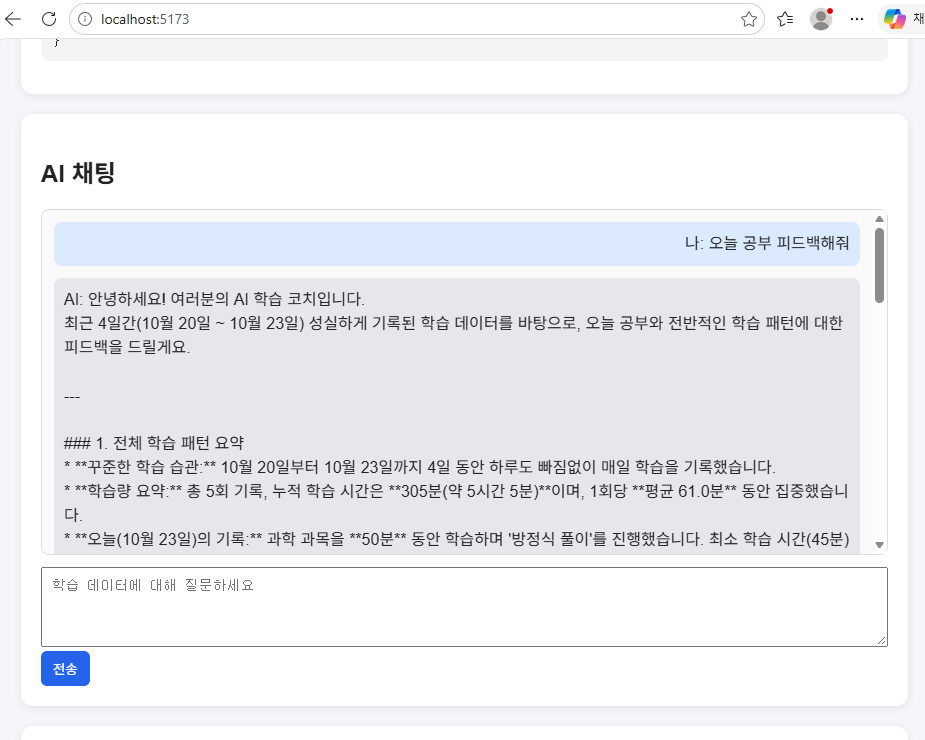
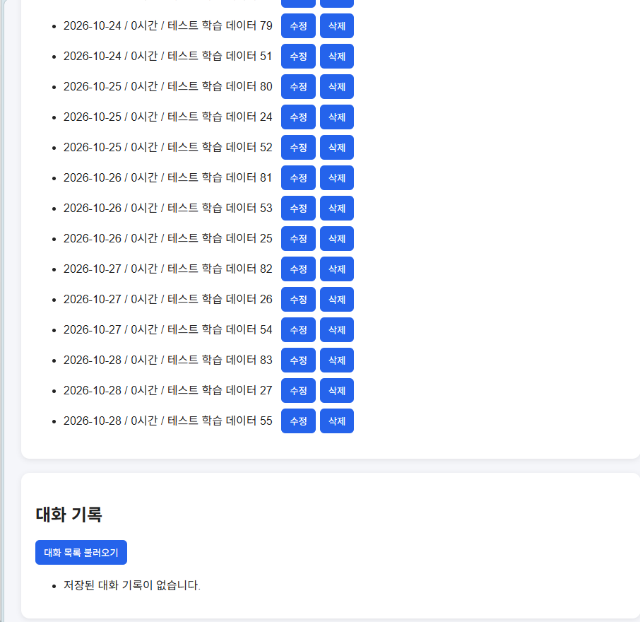
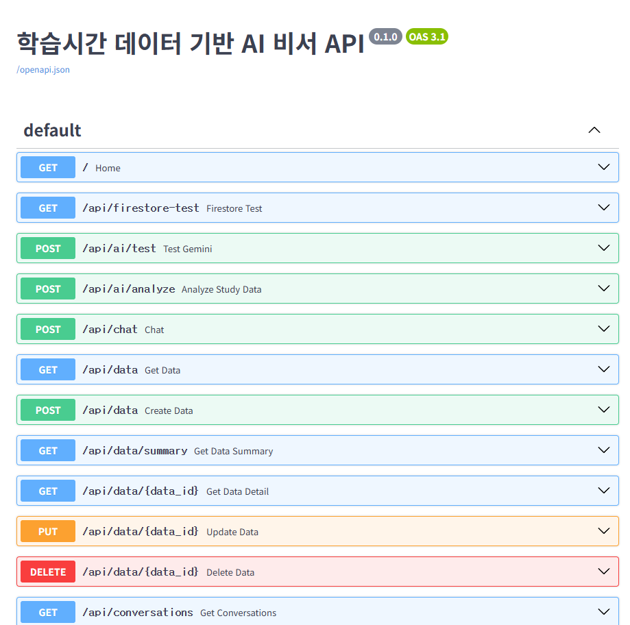

# 학습시간 AI 비서

학습시간 AI 비서는 사용자가 기록한 학습 시간 데이터를 기반으로 요약 정보를 만들고, 그 요약 정보를 AI에게 전달하여 맞춤형 학습 조언을 제공하는 웹 애플리케이션입니다.

사용자는 날짜별 학습 시간과 메모를 저장할 수 있고, 저장된 데이터를 기반으로 AI와 대화할 수 있습니다. 또한 이전 대화 기록을 저장하고 다시 불러올 수 있습니다.

---

## 1. 서비스 소개

이 프로젝트는 사용자의 학습 시간 데이터를 저장하고, 저장된 데이터를 기반으로 AI가 학습 패턴을 분석해주는 서비스입니다.

사용자는 날짜, 학습 시간, 메모를 입력하여 학습 데이터를 관리할 수 있습니다.  
AI 채팅 기능은 저장된 학습 데이터의 요약 정보를 참고하여 사용자의 질문에 맞춤형 답변을 제공합니다.

예를 들어 사용자가 다음과 같이 질문할 수 있습니다.

```txt
최근 내 학습 기록을 보고 공부 계획을 추천해줘.
```

AI는 저장된 학습 시간 데이터의 총합, 평균, 최대값, 최소값, 최근 추세 등을 참고하여 답변합니다.

---

## 2. 주요 기능

### 1) 데이터 기반 AI 채팅

사용자가 자연어로 질문을 입력하면, 백엔드는 Firestore에 저장된 학습 데이터를 요약한 뒤 해당 요약 정보를 AI 시스템 프롬프트에 포함합니다.

주요 기능은 다음과 같습니다.

- 사용자 질문 입력
- 저장된 학습 데이터 요약 조회
- 요약 정보를 시스템 프롬프트에 주입
- AI 답변 생성
- 로딩 표시
- 채팅 화면에 사용자 메시지와 AI 답변 출력
- 대화 기록 자동 저장

---

### 2) 데이터 관리 CRUD

사용자는 학습 데이터를 추가, 조회, 수정, 삭제할 수 있습니다.

데이터는 다음과 같은 형태로 저장됩니다.

```json
{
  "date": "2025-01-01",
  "value": 3,
  "memo": "수학 문제 풀이"
}
```

구현한 기능은 다음과 같습니다.

- 학습 데이터 추가
- 학습 데이터 목록 조회
- 학습 데이터 수정
- 학습 데이터 삭제
- 학습 데이터 요약 조회

---

### 3) 대화 기록 저장 및 불러오기

AI와 나눈 대화는 Firestore에 저장됩니다.

구현한 기능은 다음과 같습니다.

- 대화 기록 저장
- 대화 목록 조회
- 특정 대화 불러오기
- 대화 삭제

이를 통해 사용자는 이전에 AI와 나눈 학습 상담 내용을 다시 확인할 수 있습니다.

---

### 4) 배포 및 문서화

- 백엔드는 Render에 배포했습니다.
- 프론트엔드는 Vercel에 배포했습니다.
- FastAPI Swagger UI를 통해 API 문서를 확인할 수 있습니다.
- README에 실행 방법, 환경 변수, 배포 URL, 기능 설명을 정리했습니다.

---

## 3. 기술 스택

### Backend

- Python 3.10+
- FastAPI
- Uvicorn
- Pydantic
- Firebase Admin SDK
- Firebase Firestore
- python-dotenv
- google-genai

### Frontend

- HTML
- CSS
- JavaScript
- Vite

### Database

- Firebase Firestore

### Deployment

- Backend: Render
- Frontend: Vercel

---

## 4. 배포 URL

### Frontend

```txt
https://m2-2-theta.vercel.app
```

### Backend API

```txt
https://m2-2-backend.onrender.com
```

### Swagger UI

```txt
https://m2-2-backend.onrender.com/docs
```

> Render 무료 플랜을 사용하는 경우 서버가 일정 시간 동안 요청이 없으면 sleep 상태가 될 수 있습니다.  
> 이 경우 첫 요청이 느리거나 실패할 수 있으므로, 테스트 전에 Swagger UI 주소에 먼저 접속하여 서버를 깨운 뒤 사용하는 것을 권장합니다.

---

## 5. 프로젝트 구조

```txt
project/
├── backend/
│   ├── main.py
│   ├── requirements.txt
│   ├── .env
│   └── ...
│
├── frontend/
│   ├── index.html
│   ├── package.json
│   ├── .env
│   ├── src/
│   │   ├── main.js
│   │   └── style.css
│   └── ...
│
└── README.md
```

---

## 6. Firestore 컬렉션 구조

Firestore에는 크게 두 개의 컬렉션을 사용했습니다.

### data 컬렉션

학습 시간 데이터를 저장하는 컬렉션입니다.

예시 문서 구조는 다음과 같습니다.

```json
{
  "date": "2025-01-01",
  "value": 3,
  "memo": "수학 문제 풀이",
  "created_at": "2025-01-01T10:00:00"
}
```

| 필드명 | 설명 |
|---|---|
| `date` | 학습 날짜 |
| `value` | 학습 시간 |
| `memo` | 학습 내용 메모 |
| `created_at` | 데이터 생성 시각 |

---

### conversations 컬렉션

AI와 나눈 대화 기록을 저장하는 컬렉션입니다.

예시 문서 구조는 다음과 같습니다.

```json
{
  "title": "학습 계획 상담",
  "messages": [
    {
      "role": "user",
      "content": "최근 내 학습 패턴을 분석해줘."
    },
    {
      "role": "assistant",
      "content": "최근 학습 시간이 증가하는 추세입니다."
    }
  ],
  "created_at": "2025-01-01T10:00:00"
}
```

| 필드명 | 설명 |
|---|---|
| `title` | 대화 제목 |
| `messages` | 사용자와 AI의 메시지 목록 |
| `created_at` | 대화 생성 시각 |

---

## 7. API 명세

### 데이터 API

| Method | Endpoint | 설명 |
|---|---|---|
| POST | `/api/data` | 새 학습 데이터 추가 |
| GET | `/api/data` | 학습 데이터 목록 조회 |
| PUT | `/api/data/{id}` | 학습 데이터 수정 |
| DELETE | `/api/data/{id}` | 학습 데이터 삭제 |
| GET | `/api/data/summary` | 학습 데이터 요약 조회 |

---

### 대화 기록 API

| Method | Endpoint | 설명 |
|---|---|---|
| POST | `/api/conversations` | 대화 기록 저장 |
| GET | `/api/conversations` | 대화 목록 조회 |
| GET | `/api/conversations/{id}` | 특정 대화 불러오기 |
| DELETE | `/api/conversations/{id}` | 대화 기록 삭제 |

---

### AI 채팅 API

| Method | Endpoint | 설명 |
|---|---|---|
| POST | `/api/chat` | 데이터 요약을 기반으로 AI 답변 생성 |

요청 예시:

```json
{
  "message": "최근 내 학습 시간을 보고 공부 계획을 추천해줘."
}
```

응답 예시:

```json
{
  "answer": "최근 학습 기록을 보면 평균 학습 시간이 꾸준히 유지되고 있습니다. 다만 특정 날짜에 학습량이 줄어드는 경향이 있으므로, 짧은 시간이라도 매일 학습하는 계획을 추천합니다."
}
```

---

## 8. 데이터 요약 예시

`GET /api/data/summary` API는 저장된 학습 데이터를 바탕으로 요약 정보를 반환합니다.

응답 예시는 다음과 같습니다.

```json
{
  "period": "2025-01-01 ~ 2025-01-31",
  "count": 120,
  "metrics": {
    "total": 210,
    "average": 1.75,
    "max": 5,
    "min": 0.5
  },
  "trend": "최근 학습 시간이 증가하는 추세입니다."
}
```

| 필드명 | 설명 |
|---|---|
| `period` | 데이터 기간 |
| `count` | 전체 데이터 개수 |
| `metrics.total` | 총 학습 시간 |
| `metrics.average` | 평균 학습 시간 |
| `metrics.max` | 최대 학습 시간 |
| `metrics.min` | 최소 학습 시간 |
| `trend` | 최근 학습 시간 추세 |

---

## 9. 컨텍스트 주입 방식

이 프로젝트에서는 AI가 단순한 일반 답변을 하는 것이 아니라, 사용자의 실제 학습 데이터를 참고하여 답변할 수 있도록 구현했습니다.

이를 위해 저장된 데이터를 직접 모두 AI에게 전달하지 않고, 백엔드에서 먼저 요약 정보를 생성합니다.  
그 다음 요약 정보를 시스템 프롬프트에 포함하여 AI에게 전달합니다.

시스템 프롬프트 예시는 다음과 같습니다.

```txt
당신은 학습 데이터 분석 비서입니다.

[사용자 학습 데이터 요약]
- 데이터 기간: 2025-01-01 ~ 2025-01-31
- 총 기록 수: 120개
- 총 학습 시간: 210시간
- 평균 학습 시간: 1.75시간
- 최대 학습 시간: 5시간
- 최소 학습 시간: 0.5시간
- 최근 추세: 최근 학습 시간이 증가하는 추세입니다.

위 데이터를 기반으로 사용자의 질문에 맞춤형으로 답변하세요.
```

이 방식의 장점은 다음과 같습니다.

- 전체 데이터를 모두 전달하지 않아도 됩니다.
- 토큰 사용량을 줄일 수 있습니다.
- AI가 사용자 데이터에 맞는 답변을 생성할 수 있습니다.
- 데이터가 변경되면 요약 정보도 함께 변경되어 최신 상태를 반영할 수 있습니다.

---

## 10. 로컬 실행 방법

### Backend 실행

#### 1) 백엔드 폴더로 이동

```bash
cd backend
```

#### 2) 가상환경 생성

```bash
python -m venv venv
```

#### 3) 가상환경 활성화

Windows:

```bash
venv\Scripts\activate
```

macOS / Linux:

```bash
source venv/bin/activate
```

#### 4) 패키지 설치

```bash
pip install -r requirements.txt
```

#### 5) 환경 변수 파일 생성

백엔드 폴더에 `.env` 파일을 생성합니다.

```env
FIREBASE_CREDENTIALS={"type":"service_account","project_id":"..."}
GEMINI_API_KEY=your_gemini_api_key
ALLOWED_ORIGINS=http://localhost:5173,https://m2-2-theta.vercel.app
```

> Firebase 서비스 계정 키와 AI API 키는 코드에 직접 작성하지 않고 환경 변수로 관리합니다.

#### 6) 백엔드 서버 실행

```bash
uvicorn main:app --reload
```

실행 후 아래 주소에서 확인할 수 있습니다.

```txt
http://localhost:8000
```

Swagger UI는 아래 주소에서 확인할 수 있습니다.

```txt
http://localhost:8000/docs
```

---

### Frontend 실행

#### 1) 프론트엔드 폴더로 이동

```bash
cd frontend
```

#### 2) 패키지 설치

```bash
npm install
```

#### 3) 환경 변수 파일 생성

프론트엔드 폴더에 `.env` 파일을 생성합니다.

로컬 실행 시:

```env
VITE_API_BASE_URL=http://localhost:8000
```

배포 환경에서는 다음과 같이 Render 백엔드 주소를 사용합니다.

```env
VITE_API_BASE_URL=https://m2-2-backend.onrender.com
```

#### 4) 프론트엔드 개발 서버 실행

```bash
npm run dev
```

실행 후 브라우저에서 아래 주소로 접속합니다.

```txt
http://localhost:5173
```

---

## 11. 환경 변수 목록

### Backend 환경 변수

| 변수명 | 설명 |
|---|---|
| `FIREBASE_CREDENTIALS` | Firebase 서비스 계정 JSON 문자열 |
| `GEMINI_API_KEY` | AI API 호출을 위한 API 키 |
| `ALLOWED_ORIGINS` | CORS 허용 도메인 목록 |

---

### Frontend 환경 변수

| 변수명 | 설명 |
|---|---|
| `VITE_API_BASE_URL` | 백엔드 API 서버 주소 |

---

## 12. 배포 방법

### Backend 배포(Render)

1. 백엔드 코드를 GitHub에 push합니다.
2. Render에서 New Web Service를 생성합니다.
3. GitHub Repository를 연결합니다.
4. Build Command를 설정합니다.

```bash
pip install -r requirements.txt
```

5. Start Command를 설정합니다.

```bash
uvicorn main:app --host 0.0.0.0 --port $PORT
```

6. Render 환경 변수에 다음 값을 등록합니다.

```txt
FIREBASE_CREDENTIALS
GEMINI_API_KEY
ALLOWED_ORIGINS
```

7. 배포 후 Swagger UI에 접속하여 API 문서가 정상적으로 보이는지 확인합니다.

```txt
https://m2-2-backend.onrender.com/docs
```

---

### Frontend 배포(Vercel)

1. 프론트엔드 코드를 GitHub에 push합니다.
2. Vercel에서 New Project를 생성합니다.
3. GitHub Repository를 연결합니다.
4. 환경 변수에 다음 값을 등록합니다.

```txt
VITE_API_BASE_URL=https://m2-2-backend.onrender.com
```

5. Deploy를 실행합니다.
6. 배포된 Vercel URL에서 화면과 기능이 정상 동작하는지 확인합니다.

```txt
https://m2-2-theta.vercel.app
```

---

## 13. 기능 테스트 예시

### AI 채팅 테스트

질문 예시:

```txt
최근 내 학습 기록을 보고 공부 계획을 추천해줘.
```

확인 내용:

- 로딩 표시가 나타나는지 확인
- 사용자 메시지가 화면에 표시되는지 확인
- AI 답변이 화면에 표시되는지 확인
- 저장된 데이터 요약을 반영한 답변인지 확인
- 대화 기록에 저장되는지 확인

---

### 데이터 관리 테스트

입력 예시:

```txt
date: 2025-01-01
value: 3
memo: 수학 문제 풀이
```

확인 내용:

- 데이터 추가 후 목록에 표시되는지 확인
- 목록 불러오기 버튼을 눌렀을 때 저장된 데이터가 표시되는지 확인
- 수정 또는 삭제 기능이 정상 동작하는지 확인
- 데이터 요약 정보가 갱신되는지 확인

---

### 대화 기록 테스트

확인 내용:

- AI 채팅 후 대화가 저장되는지 확인
- 대화 목록 불러오기 버튼을 눌렀을 때 목록이 표시되는지 확인
- 특정 대화를 선택했을 때 이전 메시지가 다시 표시되는지 확인
- 대화 삭제가 정상 동작하는지 확인

---

### Swagger UI 테스트

확인 내용:

- `/docs` 주소에서 Swagger UI가 열리는지 확인
- 데이터 API가 표시되는지 확인
- 대화 기록 API가 표시되는지 확인
- 채팅 API가 표시되는지 확인

---

## 14. 제출 스크린샷

아래 이미지는 기능 동작 확인을 위한 스크린샷입니다.

> 실제 제출 시 `screenshots` 폴더를 만들고 아래 파일명에 맞게 이미지를 추가합니다.

### 1) 데이터 요약이 반영된 AI 채팅 화면



---

### 2) 데이터 관리 화면



---

### 3) Swagger UI 화면



---

